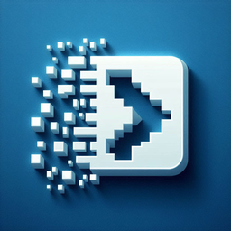
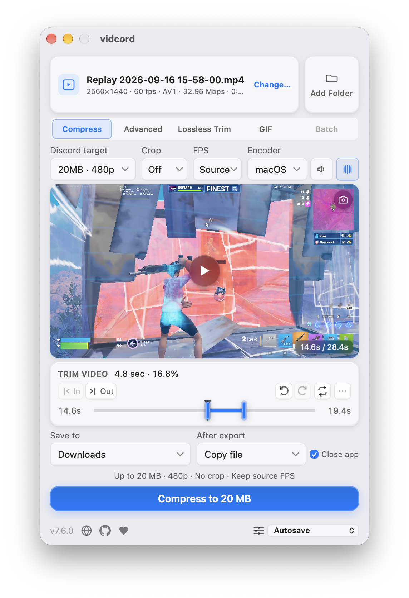
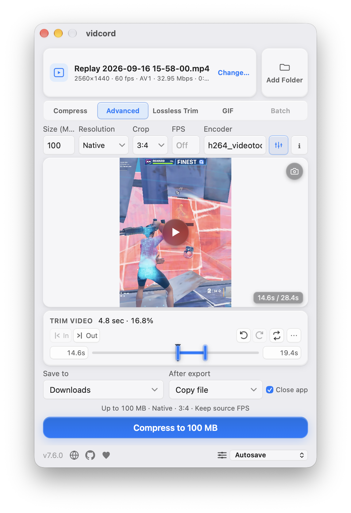
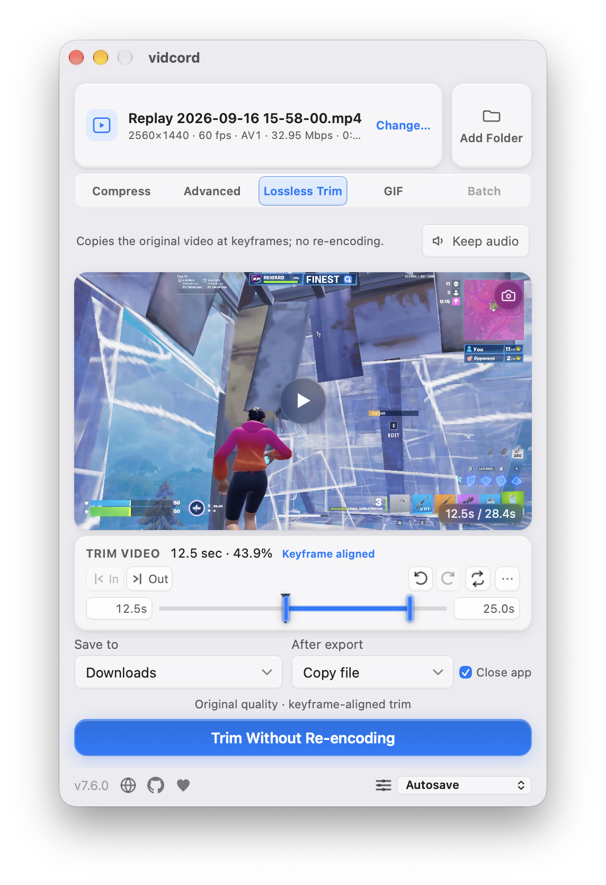
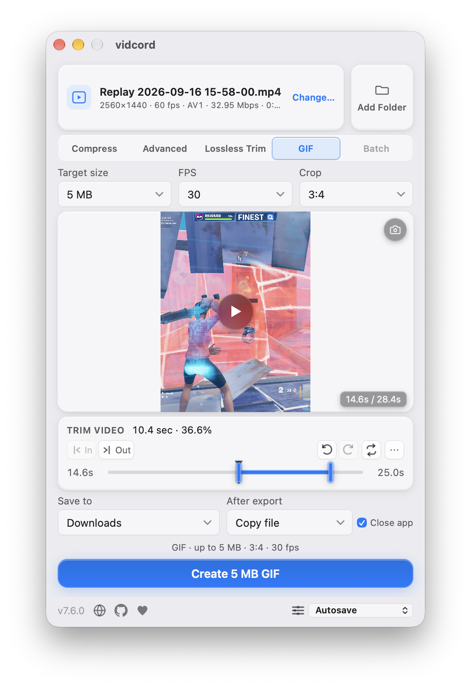
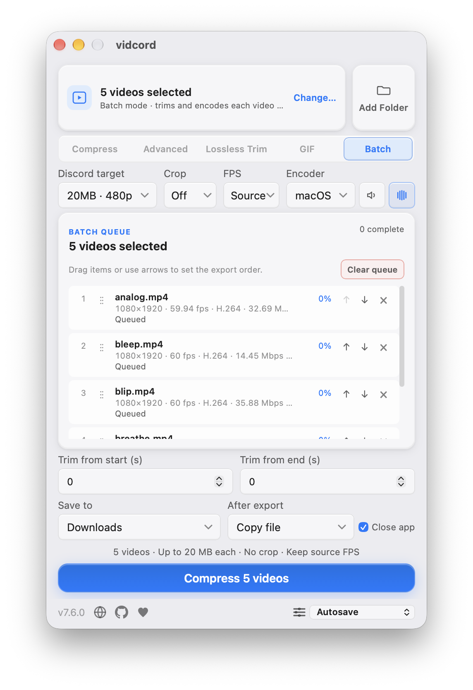
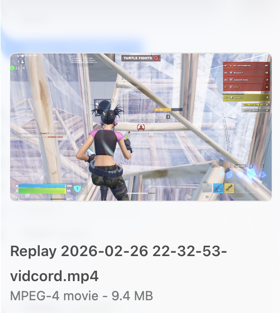
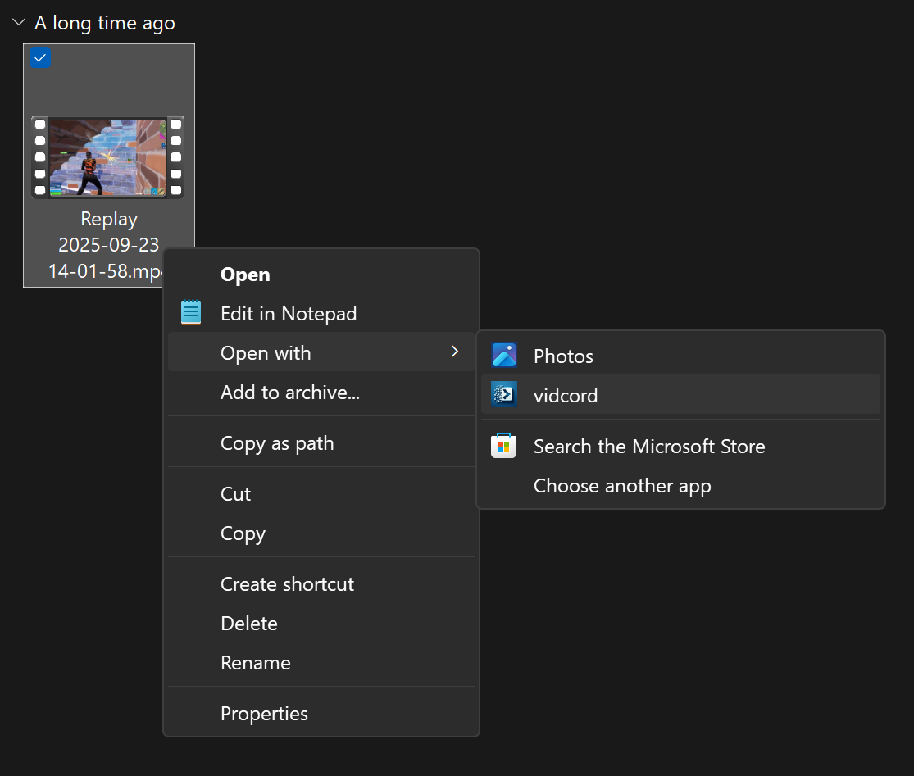
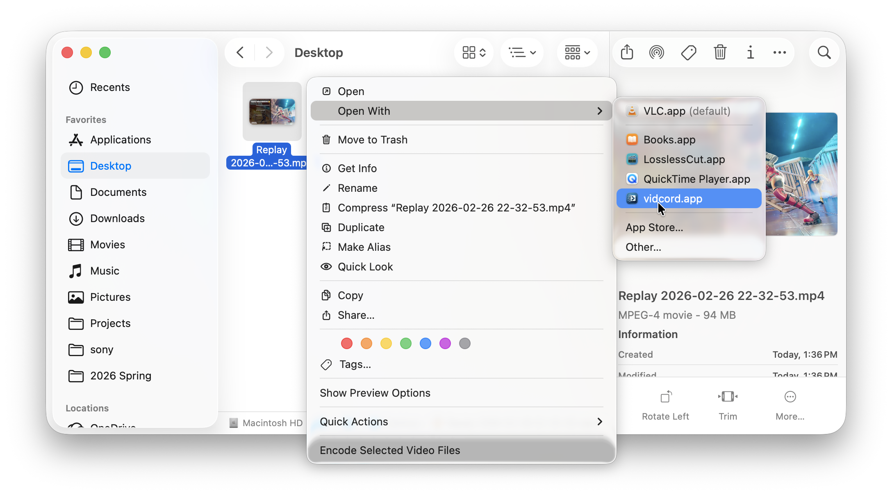

# vidcord - Free Discord Video Compressor for Web, Windows, macOS, and Linux

<p>
  
</p>

**vidcord** is a free, open-source **Discord video compressor** with a native
desktop app and a quick browser demo for no-install or mobile use when you are
in a pinch. Open [vidcord.app](https://vidcord.app/) to see the desktop workflow
first and download the Windows, macOS, or Linux app for faster system encoding,
GPU encoders, native folders, Open With, notifications, and the complete desktop
workflow. The browser demo is linked under the download button for a quick local
export from a phone, tablet, or desktop browser.

The browser demo processes selected videos locally with FFmpeg WebAssembly:
choose a **20 MB, 50 MB, 100 MB, 500 MB, or 1 GB** target, trim the clip, or choose
**Lossless Trim** to cut on source keyframes without re-encoding. Finished files
download through the browser; selected videos never leave the device. It is a
lighter fallback for quick jobs: inputs must be readable by the browser and
are limited to **512 MB per file**, and speed depends on the device, browser,
available memory, and source format. GIF Mode creates animated `.gif` or `.webp` exports
with **5 MB**, **10 MB**, or **20 MB** size targets.

Select multiple videos through the browser's file picker or drag-and-drop to
enter browser **Batch mode** automatically. The browser queue applies the same
standard Compress profile to each full-duration video and downloads each MP4.
Reorder the queue with drag-and-drop or arrow controls, and retry failed or
cancelled files without rerunning completed downloads.
The desktop app additionally supports folder imports from drag-and-drop, the
folder picker, and file-manager context menus, plus Open With, command-line file
arguments, second-instance forwarding, per-video batch trims, native output
handling, and native parallel workers. Folder imports scan subfolders up to a
safety limit, queue supported videos, report skipped files, and warn when a
large scan stops before it reaches every item.

The native desktop app imports **MP4, MOV, MKV, AVI, WebM, FLV, and WMV**;
codec support within those containers depends on your system [FFmpeg](https://ffmpeg.org) install. It
adds hardware-accelerated encoding (NVIDIA NVENC, AMD AMF, Intel Quick Sync,
Linux VAAPI, Apple VideoToolbox), automatic bitrate calculation, strict output
size checks, output FPS controls, and platform-native installers. Both editions
process videos locally; neither requires an account and vidcord collects no
automatic usage telemetry. User-submitted feedback goes to the developer. The
desktop app is built with [Tauri 2](https://tauri.app) (Rust + React); the browser edition is
the same React frontend paired with FFmpeg WebAssembly.

<p>
  
  
  
  
  
  
</p>



> **At a glance** — Native desktop app at [vidcord.app](https://vidcord.app/) ·
> Windows 10/11, macOS 11+, and Linux · x86_64 + aarch64 · Native installers ·
> Discord targets 20 / 50 / 100 / 500 MB / 1 GB · Hardware acceleration and OS
> integrations on desktop · Desktop requires system FFmpeg on `PATH` · Quick
> browser demo with no install, local FFmpeg WebAssembly, and browser
> downloads · MIT licensed.

---

## Contents

- [Why vidcord](#why-vidcord)
- [Best for](#best-for)
- [Features](#features)
- [Screenshots](#screenshots)
- [Download vidcord](#download-vidcord)
- [Browser edition](#browser-edition)
- [FFmpeg setup](#ffmpeg-setup-for-the-desktop-app)
- [Usage](#usage)
- [Keyboard shortcuts](#native-desktop-keyboard-shortcuts)
- [Hardware acceleration](#hardware-acceleration)
- [Building from source](#building-from-source)
- [Project layout](#project-layout)
- [Troubleshooting](#troubleshooting)
- [FAQ](#faq)
- [Contributors](#contributors)
- [Contributing](#contributing)
- [License](#license)
- [Acknowledgements](#acknowledgements)

---

## Why vidcord

Discord's current upload limits are 20 MB (free), 50 MB (Nitro Basic /
Boost Level 2), 100 MB (Boost Level 3), and 1 GB (Nitro). Both editions pick
a target bitrate for the clip length you want and verify the result against the
selected size limit. The browser edition keeps the input in the page and
downloads the export through the browser. The desktop app can choose from the
video encoders exposed by system FFmpeg, save to **Downloads** by default or
another native destination, copy the finished file to the system clipboard,
and retry oversized results with safer bitrates and CPU fallback.

- **Platform-native packaging.** Tauri uses the system WebView (Edge on Windows,
  WebKit on macOS/Linux) instead of bundling Chromium. Linux offers APT, RPM,
  and pacman packages with system dependencies and desktop/file associations,
  plus portable AppImages. Package size varies by platform: Windows installers
  are the smallest and macOS ships a universal DMG.
- **Desktop-speed encoding.** The native app auto-detects hardware encoders:
  NVENC, AMF, QSV, VAAPI, and VideoToolbox.
- **Local video processing.** Selected videos stay on your device. No account is required, and
  vidcord collects no automatic usage telemetry. If you submit feedback, the report goes to the
  developer with diagnostics described in the form.

## Best for

| Need                                                    | How vidcord helps                                                                                                                                        |
| ------------------------------------------------------- | -------------------------------------------------------------------------------------------------------------------------------------------------------- |
| Compress a video for Discord free upload limits         | Use the 20 MB target, trim the clip, and remove audio if needed.                                                                                         |
| Compress large MP4, MOV, MKV, AVI, or WebM files        | The desktop app uses system FFmpeg; the browser edition accepts formats its browser can decode.                                                          |
| Compress several videos in one pass                     | Browser Batch applies shared settings to full-duration files with reorder/retry controls; desktop Batch adds trims, native workers, and output handling. |
| Preserve original video quality while trimming          | Use Lossless Trim for keyframe-aligned stream-copy output without re-encoding.                                                                           |
| Turn a video clip into a Discord GIF                    | Enable GIF Mode and choose the 5 MB, 10 MB, or 20 MB target.                                                                                             |
| Make a video fit Discord Nitro or boosted server limits | Pick the 50 MB, 100 MB, 500 MB, or 1 GB target without calculating bitrates by hand.                                                                     |
| Keep video compression private                          | Everything runs locally on your computer; no web upload step.                                                                                            |
| Need a quick no-install export, including on mobile     | Use the browser demo for local WebAssembly processing and browser downloads; it is best for browser-readable files up to 512 MB each.                    |
| Use GPU video encoding from a simple GUI                | vidcord auto-detects NVENC, AMF, QSV, VAAPI, and VideoToolbox encoders.                                                                                  |
| Cap output frame rate for smaller files                 | Leave FPS unchanged, or choose a lower output FPS when Discord size is tight.                                                                            |

## Features

- **Desktop saved settings presets** — the native app autosaves the last settings used by default;
  use the bottom-right preset dropdown to save, restore, and delete up to 20 named compression and
  mode configurations. Names are limited to 40 characters; changing a saved preset's settings
  returns the selector to Autosave, while output destination, completion action, and close-app
  preference remain separate autosaved settings.

- **Desktop Batch mode** — selecting two or more videos switches from the single-video
  workflows automatically. The queue probes and shows each file's resolution, frame rate, codec,
  bitrate, and duration, with per-file queued, encoding, completed, failed, or cancelled states.
  Batch uses standard Compress controls only, always writes MP4 output, and provides separate
  start-trim and end-trim seconds that default to `0`. Reorder items with drag-and-drop or the
  keyboard arrow controls, remove queued items before export, or use **Clear queue** to remove all
  queued videos at once. Retry failed or cancelled items individually or together without rerunning
  completed outputs. Saved presets cannot be restored while Batch is active, keeping its shared
  Compress profile intact. When a trim would leave less than one second, the two trim values are
  reduced proportionally.
- **Desktop parallel batch encoding** — up to two videos encode concurrently by default. If the selected
  encoder reports a device, session, or resource-contention error, remaining work continues one
  video at a time. Individual probe or encode failures do not stop the queue, and aggregate
  progress and ETA cover the whole remaining batch rather than only the currently active item.
- **Desktop folder imports** — drop a folder, choose one or more folders with **Add Folder**, or
  choose **Import folder in vidcord** from a Windows folder menu, **Open With → vidcord** in Finder,
  or **Open With → vidcord** in a Linux file manager. Linux packages register
  their desktop entry and associations at install; AppImages register the folder
  action for the current user on first launch. vidcord scans subfolders up to a safety limit, shows scan progress,
  queues supported videos, reports skipped or unreadable items, and warns if results may be
  incomplete.
- **Five Discord target profiles** covering current Discord tiers:
  - 20 MB @ 480p — Discord free tier
  - 50 MB @ 720p — Nitro Basic / Boost Level 2
  - 100 MB @ 1080p — Boost Level 3 or
    [Clips Bypass](https://github.com/riolubruh/YABDP4Nitro?tab=readme-ov-file#clips)
  - 500 MB @ native — legacy Nitro limit
  - 1 GB @ native — Nitro
- **GIF Mode** — export an optimized animated GIF or WebP for a 5 MB, 10 MB, or 20 MB
  target at 15, 30, or Discord-safe maximum 50 FPS. Choose the output format in the GIF
  settings. Video-only encoder, audio,
  and unrelated video controls are hidden while GIF Mode is active; the aspect-ratio crop selector
  remains available because it still applies to animated image output. Higher frame rates trade
  spatial detail for motion, and oversized exports are retried at
  progressively lower visual complexity without changing the selected FPS.
- **Advanced mode** — custom target size (MB), output resolution, FPS, and audio
  normalization in both editions. The desktop app additionally accepts any
  FFmpeg video encoder string, offers autocomplete from installed encoders, and
  provides a per-video audio-track selector; the browser shows track choices when
  its media APIs expose multiple tracks. Preview plays only the first selected
  track when several are selected. Leave target size empty to encode at
  the source bitrate without a file-size limit.
- **Aspect-ratio cropping** — available in Compress, Advanced, and GIF Mode;
  crop to 16:9, 1:1, 9:16, 4:3, 3:4, 4:5, or 5:4 before scaling. A preset
  matching the imported video's native display ratio is hidden automatically.
- **Smart audio output** — both editions can peak-normalize retained audio so its
  highest sample peak reaches `0 dB` with a fixed gain, or remove audio. The
  desktop app starts with the first source track, switches to a later track only
  when it is at least 20% larger by estimated data, and can retain multiple separate tracks
  in Advanced mode; each selected track is encoded at 128 kbps and included in
  the video bitrate budget. Browser Advanced shows track choices when its media
  APIs expose them, otherwise it keeps the first stream. Preview plays only the
  first selected track.
- **Frame snapshots** — save the current frame as a full-resolution PNG with the preview overlay.
  Desktop snapshots preserve the pixel dimensions of the selected frame or crop for PNGs up to
  128 MiB, and follow the configured output destination, completion action, and separate close-app
  setting; browser snapshots download through the browser.
- **Output FPS controls** — standard mode can leave FPS unchanged or cap it
  at 24, 30, or 60 FPS. The desktop app hides choices at or above the FFprobe
  frame rate when they would be redundant. The browser applies the same
  filtering when its metadata includes the source rate; when that rate is
  unavailable, it shows all standard choices and applies the selected rate.
  Advanced mode accepts a custom FPS value, or an empty field shown as Off
  for no change.
- **Desktop completion actions** — copy the finished output file to the system
  clipboard by default, with an automatic reveal fallback; show it in
  Explorer/Finder; or do nothing. A separate setting can close the app after a
  successful export.
- **Desktop trim timeline** with fine-grained handles, draggable playhead, snap
  controls, zoom, pan, undo/redo, and optional looped playback. The browser
  editor keeps handles, a playhead, history, loop playback, snap intervals,
  zoom, and pan in its lighter timeline.
- **Lossless Trim** — use the dedicated copy-mode tab beside Advanced to
  preserve source streams with a fast keyframe-aligned stream copy. Both
  editions discover source keyframes locally, and both can remove all audio
  tracks without re-encoding the video. When a selected segment is
  estimated to fit a chosen size target at the source bitrate, the desktop app
  offers this mode with a keyframe-precision warning. Boundaries snap outward
  to source keyframes; the desktop app prefers an MP4 stream-copy output, then
  the validated source container, and falls back to normal compression when
  neither is compatible.
- **Desktop HTML video preview** — the Tauri controls seek, play, and pause the current video
  on Windows, macOS, and Linux. Snapshots capture the displayed video frame. Format support depends
  on the platform media engine; Linux packages install GStreamer plugins through the system package
  manager, while AppImages bundle GStreamer for WebKitGTK playback.
- **Desktop hardware acceleration**, auto-detected at startup:
  - NVIDIA NVENC (`h264_nvenc`, `hevc_nvenc`)
  - AMD AMF (`h264_amf`, `hevc_amf`)
  - Intel Quick Sync (`h264_qsv`, `hevc_qsv`)
  - Linux VAAPI (`h264_vaapi`, `hevc_vaapi`)
  - macOS VideoToolbox (`h264_videotoolbox`, `hevc_videotoolbox`)
- **Desktop ways to open videos:** drag-and-drop videos or folders onto the
  window, use **Browse File** or **Add Folder**, choose vidcord from the folder
  context menu, pass command-line file arguments, or launch a second instance.
  macOS uses Finder's **Open With** menu; Linux packages register file-manager
  associations at install and AppImages register the folder action on first
  launch. Selecting one video preserves the normal workflow;
  multiple videos activate Batch mode.
- **Source details at import** — the desktop app shows resolution, frame rate,
  codec, average bitrate, and duration from FFprobe. The browser shows the
  dimensions, container information, file-size-based bitrate estimate, and
  duration available from browser media metadata; exact codec and track details
  depend on the browser.
- **Desktop compact fixed-size window** — stays fixed at 460×690, with standard and
  advanced controls fitted into the app surface; long Batch queues use an
  internal scrollbar rather than expanding the window.
- **System-matched macOS chrome** — the native title bar follows macOS Light
  and Dark appearances together with the app surface.
- **Remove audio in re-encoded modes** — strip the audio track to reclaim space.
- **Strict size checks with bounded retries** — finished files are measured
  against the selected target. Long target-size video exports use a short sample
  to improve the initial bitrate estimate. When an output is well below its size
  limit, bounded refinement passes can use more of the available size while
  preserving the best in-range result if a later pass fails. Target-size encodes
  apply encoder-specific peak-rate bounds and bounded measured-bitrate correction.
  Hardware output can fall back to CPU; if no attempt fits, vidcord reports the
  smallest result.
- **Real-time desktop progress** with ETA, current attempt number, encoder, and
  bitrate parsed from FFmpeg's stderr. Browser exports show in-page progress and
  ETA; Batch progress is aggregated across the applicable queue.
- **OS taskbar & dock progress integration** — reflects encoding progress directly on your OS taskbar or dock icon (macOS Dock, Windows Taskbar button, Linux Unity launcher bar) so you can track encoding while unfocused.
- **Native system notifications** — mirrors every in-app banner and error in order as
  a matching OS notification while vidcord is unfocused on Windows, macOS, and Linux;
  clicking a notification restores and focuses the app.
- **Race-safe cancellation** — cancelling keeps the job owned until FFmpeg
  exits, prevents another encode from starting early, removes partial output,
  terminates active batch children, and skips queued batch items.
- **Desktop collision-safe auto-named output** — direct destination modes atomically
  reserve `name-vidcord.mp4` before encoding and bump `-1`, `-2`, … if needed,
  even if another file appears at the intended path just before compression starts.
  Batch allocation reserves one unique MP4 path per input.
- **Desktop flexible output location** — save to Downloads, beside the imported clip,
  to a remembered custom folder, or choose a filename after compression finishes.
  For a batch using Ask when done, successful outputs are staged until one
  destination folder is chosen and then published together.
- **Verified desktop updates** — Windows, macOS, AppImages, and Linux installs without a
  configured vidcord package repository use GitHub update checks, which run
  after startup settles and no more than once every six hours. After approval,
  vidcord streams the matching installer to Downloads, validates its size and
  completeness, compares the bytes with GitHub's SHA-256 digest, verifies the
  independent Ed25519 release signature, and chooses an unused filename. Windows/macOS
  open the installer; Linux reveals the executable AppImage for manual replacement.
  Installed Linux packages use APT, DNF, or pacman when the vidcord repository is configured.
- **Desktop automated FFmpeg setup assistance** — Windows installers offer `winget`,
  and first launch prompts to install through the platform package manager.
  No FFmpeg binaries are bundled with vidcord.
- **Support vidcord** — a heart icon in the desktop app footer and a Support section
  on the website (with a matching top-nav link) point at
  [GitHub Sponsors](https://github.com/sponsors/cyroz1).
- **Cross-platform installers:** Windows NSIS (x86_64 + aarch64), macOS
  universal `.dmg`, Linux `.deb`, `.rpm`, and pacman packages (x86_64 + aarch64), and
  `.AppImage` downloads for both Linux architectures.

### Desktop input formats

The desktop import allowlist is MP4, MOV, MKV, AVI, WebM, FLV, and WMV.
Codec support within those containers depends on the installed FFmpeg build. Standard and Advanced mode output is
`.mp4` — H.264 (AVC) by default or H.265 (HEVC) if you pick an `hevc_*`
encoder. Lossless Trim prefers `.mp4` and can use the validated source video
extension when the source container is the compatible stream-copy choice. GIF
Mode creates an animated `.gif` or `.webp`, according to the selected output format.

The browser edition accepts video files that the browser can decode. It recognizes
common video extensions including MP4, MOV, MKV, AVI, WebM, FLV, WMV, M4V, MPEG,
MPG, and OGV, but a browser may reject a container or codec that the desktop
FFmpeg build can read.

## Browser edition

Use the hosted [browser editor](https://vidcord.app/#web-editor) when you are
in a pinch and need a quick local export without installing the desktop app.
It is suitable for a phone, tablet, or desktop browser when the input is
browser-readable. The site leads with the desktop app and links this demo
directly under the primary download button. The editor renders before
requesting FFmpeg compiled to WebAssembly. After import metadata is ready, it
warms the encoder; export and Lossless Trim discovery also load it when needed. Selected files
stay in the browser, and videos and PNG frame snapshots use normal browser
downloads. Single Advanced, Lossless Trim, and GIF/WebP exports also attempt a
browser clipboard write for outputs up to 8 MiB when supported, with a two-second
deadline. This is automatic best-effort copying; there is no native completion-action
setting. Compress and Batch use downloads only.

The browser editor includes Compress, Advanced, Lossless Trim, GIF, single-file
trim and preview, crop, audio normalization, audio removal for re-encoded
exports, lossless audio removal, standard FPS controls, typed Advanced FPS up to 240, snapshots, and same-profile multi-file batches. In
Advanced mode it can select source audio tracks when browser media APIs expose
them, with preview playback using only the first selected track. Each
selected browser input is capped at 512 MB because FFmpeg WebAssembly processes
the file in browser memory. Browser Batch accepts up to 12 files and applies
one standard Compress profile to each file at full duration, reports per-file
progress and aggregate ETA, continues after individual failures, and supports
queue reordering, removal, and retrying failed or cancelled files without
rerunning completed downloads. Cancellation also stops encoder loading and
metadata reads. It does not expose per-file batch trim fields or a batch preview
timeline. After metadata is ready, the editor warms the local encoder and shows
encoder-load and export-stage progress. It warns before exports estimated to
need substantial memory; phones use a faster x264 preset to reduce encode time.

If a browser audio decoder or filter is incompatible, the exporter can retry
without normalization or audio and reports that change. A worker that stops
emitting progress for four minutes is stopped, with one automatic export retry.

The browser encoder is intentionally fixed to `libx264` in WebAssembly. Advanced
mode can set a custom target size, resolution, and FPS, and can select source
audio tracks when browser media APIs expose them. Otherwise, re-encoded exports
use the first audio stream exposed by the browser. Lossless Trim copies the source streams at
locally discovered keyframes and can omit audio streams with `-an`. Keyframe
discovery is limited to 60 seconds and 100,000 keyframes; if it exceeds either
limit, use Compress or the desktop app for that file. Its trim panel supports
snap intervals, zoom, and pan. Browser input support and performance depend on
the browser, device, available memory, and source format.

The browser edition does not provide the desktop app's system FFmpeg, GPU
encoder discovery, native output folders, Open With routing, saved settings
presets, native completion actions, OS notifications, taskbar/Dock progress, or
in-app installer updates. Linux packages use package-manager updates when both the package and vidcord repository
are configured. One-off package installs without the repository keep GitHub update checks.
On Linux, the verified download is an AppImage revealed for manual replacement; it does
not upgrade an installed `.deb`, `.rpm`, or pacman package.
Browser exports always use the browser download flow;
the browser controls its download location and any download prompts. For large,
long, unsupported, or memory-intensive sources—or when you need those desktop
integrations—use the native app.

### Browser and desktop capability matrix

| Capability             | Browser demo at `/#web-editor`                                                      | Native desktop app                                                                |
| ---------------------- | ----------------------------------------------------------------------------------- | --------------------------------------------------------------------------------- |
| Processing engine      | Local FFmpeg WebAssembly                                                            | Local system `ffmpeg` and `ffprobe`                                               |
| Video encoder          | Fixed `libx264`                                                                     | CPU and detected GPU encoders, selectable on desktop                              |
| Inputs                 | Formats the browser can decode                                                      | MP4/MOV/MKV/AVI/WebM/FLV/WMV; installed FFmpeg codecs                             |
| Modes                  | Compress, Advanced, Lossless Trim, GIF (GIF or WebP)                                | Compress, Advanced, Lossless Trim, GIF (GIF or WebP)                              |
| Audio                  | Normalize/remove; Advanced track choices when exposed; preview plays first selected | Separate track selection, normalization, or removal; preview plays first selected |
| Batch                  | Up to 12 files; shared Compress profile, full duration, browser downloads           | Shared controls plus per-file trims and native workers                            |
| Output                 | Browser downloads                                                                   | Downloads, source folder, custom folder, or save prompt                           |
| Saved settings presets | Not available                                                                       | Available in the desktop footer                                                   |
| Native integrations    | None                                                                                | Open With, clipboard/reveal, notifications, taskbar/Dock                          |

To build the static browser bundle locally:

```sh
npm run web:build
```

This writes the deployable browser bundle to the root of `site/` alongside the
crawler files. The editor renders before the encoder is requested, then warms the deferred local
WebAssembly encoder after an imported video has readable metadata. Export and keyframe
discovery also load it when needed; no selected video is sent to a server. The build stores
the WebAssembly binary as a gzip-compressed asset so the static deployment stays
within Cloudflare's per-file size limit, then decompresses it in the browser
before starting FFmpeg. The root page combines the desktop download story with the quick
browser demo.

## Screenshots

The screenshots below show the native desktop app that headlines the website.
The browser demo at [vidcord.app/#web-editor](https://vidcord.app/#web-editor)
uses the same light editor visual language and supported core workflow, with the
desktop-only controls listed in the capability matrix removed.

| Compress mode                                                                                                         | Advanced mode                                                                                                                        | Lossless Trim                                                                                                                      | GIF mode                                                                                                                          | Batch mode                                                                                                             |
| --------------------------------------------------------------------------------------------------------------------- | ------------------------------------------------------------------------------------------------------------------------------------ | ---------------------------------------------------------------------------------------------------------------------------------- | --------------------------------------------------------------------------------------------------------------------------------- | ---------------------------------------------------------------------------------------------------------------------- |
|  |  |  |  |  |

| Output file                                                                                           | Windows context menu                                                                                                      | macOS Finder                                                                                                    |
| ----------------------------------------------------------------------------------------------------- | ------------------------------------------------------------------------------------------------------------------------- | --------------------------------------------------------------------------------------------------------------- |
|  |  |  |

## Download vidcord

The [native desktop app](https://vidcord.app/#download) is the primary website
entry point for native speed, GPU encoders, OS integrations, or the full desktop
workflow. For a quick no-install export, use the browser demo linked directly
under the download button or open
[vidcord.app/#web-editor](https://vidcord.app/#web-editor). For installers, use
the desktop download section at
[`vidcord.app/#download`](https://vidcord.app/#download) or grab the latest
installer from GitHub:

**→ [Download latest release](https://github.com/cyroz1/vidcord/releases/latest)**

| Platform          | Architecture | File                                               |
| ----------------- | ------------ | -------------------------------------------------- |
| Windows 10/11     | x86_64       | `vidcord_<version>_x64-setup.exe`                  |
| Windows 10/11     | aarch64      | `vidcord_<version>_arm64-setup.exe`                |
| macOS 11+         | universal    | `vidcord_<version>_universal.dmg`                  |
| Debian / Ubuntu   | x86_64       | APT repository and `vidcord_<version>_amd64.deb`   |
| Debian / Ubuntu   | aarch64      | APT repository and `vidcord_<version>_arm64.deb`   |
| Fedora / DNF      | x86_64       | RPM repository and `vidcord_<version>_x86_64.rpm`  |
| Fedora / DNF      | aarch64      | RPM repository and `vidcord_<version>_aarch64.rpm` |
| Arch Linux        | x86_64       | pacman repository or `vidcord-bin-<version>-1-x86_64.pkg.tar.zst` |
| Arch Linux ARM    | aarch64      | pacman repository or `vidcord-bin-<version>-1-aarch64.pkg.tar.zst` |
| Portable AppImage | x86_64       | `vidcord_<version>_amd64.AppImage`                 |
| Portable AppImage | aarch64      | `vidcord_<version>_aarch64.AppImage`               |

See the [Linux install guide](docs/LINUX_INSTALL.md) for repository setup,
dependency handling, package-manager updates, and removal. Native packages
register desktop and file associations. **Running the portable Linux AppImage:** make it executable with

> `chmod +x vidcord_*.AppImage` first. AppImages need FUSE on the host:
> `sudo apt install libfuse2` (Debian/Ubuntu), `sudo dnf install fuse-libs`
> (Fedora), or `sudo pacman -S fuse2` (Arch).

> **The desktop app needs FFmpeg.** Debian/Ubuntu and Arch packages install it
> as a dependency; Fedora users can install it through RPM Fusion. Other
> installation methods can offer setup on first launch. vidcord does not bundle
> FFmpeg. The browser edition loads FFmpeg WebAssembly and does not require a
> system FFmpeg install.

The website detects the operating system. Linux opens the APT, RPM, and pacman
install guide and links to the `.deb`, `.rpm`, pacman, and AppImage files
published with the latest release. Windows links to the matching architecture-specific installer, and
macOS links to the universal DMG.
If Windows architecture is uncertain, the site asks you to choose x86_64 or
ARM64. If release metadata cannot be fetched or an installer is missing, it
falls back to the GitHub release page. Mobile devices show the desktop platform
choices without recommending an installer for the device.

## FFmpeg setup for the desktop app

The native desktop app shells out to the system `ffmpeg` and `ffprobe` binaries,
which must be on `PATH`. If they aren't, vidcord can prompt on first launch and
attempt a package-manager install: `winget` on Windows, `brew` on macOS, or
apt/dnf/pacman on Linux with privilege confirmation. The browser editor does not
use these system commands.

### Windows

```powershell
winget install Gyan.FFmpeg
```

The vidcord installer and first-launch setup can run this for you when FFmpeg is
missing. vidcord recognizes WinGet's FFmpeg install directory immediately, even
when the running process has not received the updated `PATH`.

### Windows (aarch64 — Surface Pro X, Snapdragon PCs)

vidcord tries the same `winget` setup first. If the package is unavailable for
your ARM64 PC, see [FFMPEG_SETUP.md](docs/FFMPEG_SETUP.md) for the community build
and manual PATH steps.

### macOS

```sh
brew install ffmpeg
```

### Linux

```sh
sudo apt install ffmpeg        # Debian / Ubuntu
sudo dnf install ffmpeg        # Fedora (needs RPM Fusion)
sudo pacman -S ffmpeg          # Arch / Manjaro
```

For more distros, manual installs, or troubleshooting, read
[FFMPEG_SETUP.md](docs/FFMPEG_SETUP.md).

## Usage

### Browser editor

1. Open [vidcord.app](https://vidcord.app/) and choose **Browse File**, or drag
   a browser-readable video onto the editor. On a phone or tablet, use the
   browser's file picker. Each selected browser input must be 512 MB or smaller
   because processing happens in WebAssembly memory.
2. Choose **Compress**, **Advanced**, **Lossless Trim**, or **GIF**. Use the
   Discord target, crop, FPS, audio, and trim controls that apply to the mode.
   Advanced mode accepts a positive typed FPS value up to 240; source-rate
   metadata is used to hide redundant standard FPS choices. The trim options panel also provides snap intervals and
   timeline zoom/pan controls.
3. Click the export button. FFmpeg WebAssembly finishes loading locally if needed, progress and ETA
   update in the page, and the finished video downloads through the browser.

Selecting multiple files enters browser Batch mode. The same standard Compress
profile is applied to each full-duration file; the queue shows per-file progress,
aggregate progress, and ETA, lets you reorder/remove videos, and can retry failed
or cancelled items without rerunning completed downloads.
Browser Batch accepts up to 12 files, does not offer per-file trim fields or a
batch preview timeline, and always uses browser downloads rather than desktop
output destinations.

### Native desktop app

Opening one video uses the normal single-video workflows. Select two or more
supported videos to activate Batch mode automatically; Browse, drag-and-drop,
Open With, command-line file arguments, and second-instance forwarding all
preserve the full selection.

1. **Open videos** — drop videos or a folder onto the window, choose **Import
   folder in vidcord** from a Windows folder menu, **Open With → vidcord** in
   Finder or a Linux file manager, or click **Browse File** or **Add Folder**.
   Linux packages register their desktop entry and file associations at install;
   AppImages register the folder action on first launch. Folder imports scan
   subfolders up to a safety limit, show progress, and report skipped files,
   linked folders, or unreadable items. If a large scan reaches the limit,
   vidcord warns that its results may be incomplete.
2. **Choose where to save** — use Downloads, the imported clip's folder, a
   remembered custom folder, or **Ask when done**. After export, choose **Copy file**,
   **Show in folder**, or **Do nothing**; optionally enable **Close app** after a
   successful export.
3. **Pick a mode or target** — choose **Compress**, **Advanced**, **Lossless
   Trim**, or **GIF**, then select a target size for that mode: 20/50/100/500 MB or 1 GB for video or
   5/10/20 MB for GIF or WebP. GIF Mode lets you choose the output format.
   Compress, Advanced, and GIF Mode expose the aspect-ratio crop selector;
   Advanced also exposes custom target size, resolution, FPS, audio normalization,
   and encoder controls. Leaving its size empty uses the source bitrate
   without a file-size limit. Standard mode can cap output FPS at 24, 30, or 60
   when those values are below the source frame rate.
4. **Trim** (optional) — drag the handles or use `I` / `O` to stamp the
   playhead. `Space` plays the selected range from the current playhead when it
   is inside the trim.
5. **Choose audio handling** — keep the prioritized track, peak-normalize it to 0 dB, or
   remove audio to reserve more bitrate for video. In Advanced mode, open the
   track picker beside the mute and normalize buttons to inspect every source track,
   select individual tracks or all tracks, and keep that choice for this video
   only; each selected track reserves 128 kbps.
6. **Export.** Compress and Advanced re-encode to the selected target, Lossless
   Trim uses **Trim Without Re-encoding** after keyframe discovery, and GIF mode
   creates the selected animated GIF or WebP format. Progress shows the current attempt, encoder,
   bitrate, and ETA for encoding modes; when the export is done, vidcord reports
   the result and runs your selected completion action.

In Batch mode, the queue shows source details and per-file status while each
video uses the same standard Compress target, crop, FPS, encoder, audio, and
separate start/end trim settings. Up to two encodes run in parallel by default;
resource contention switches the remaining queue to one-at-a-time processing.
The queue continues after individual probe or encode failures, reports an
aggregate ETA for the remaining work, and skips queued items when cancelled.
Drag items or use the per-row arrows to choose the execution order before starting. **Clear queue**
removes every queued video at once. After a run, Retry reprocesses only failed or cancelled entries;
completed items and their outputs remain in place. Saved presets are disabled while Batch mode is
active so all queued videos use the shared Compress profile.

The desktop footer preset selector starts at **Autosave**. Save the current
compression and mode settings as a named preset, restore it later, or delete it;
if you change one of those settings afterward, the selector returns to Autosave
to show that the saved preset no longer matches. Output destination, custom
folder, completion action, and close-app preference are saved independently for
the next launch. The browser editor has no saved setting-preset UI.

Compression goes to `~/Downloads/<original-name>-vidcord.mp4` by default, with
`-1`, `-2`, … appended if the name is taken. Lossless Trim uses the same
collision-safe naming and may use the source video extension when stream copying
requires it.

Batch compression always produces MP4 outputs. Direct destinations reserve a
unique path for every successful item. With **Ask when done**, all successful
outputs are staged until one destination folder is chosen, then published
together without overwriting existing files. The default completion action
copies successful outputs as one clipboard group; the reveal action selects successful outputs through the platform file manager. Linux
falls back to opening the containing folder if its file-selection service is unavailable. Do
nothing leaves the outputs saved without copying, opening a folder, or sending
a system notification. The independent close-app setting exits after a fully
successful batch.

## Native desktop keyboard shortcuts

| Key                        | Action                                   |
| -------------------------- | ---------------------------------------- |
| `Space`                    | Play / stop preview from the playhead    |
| `,` / `.`                  | Step 1/30 second back / forward          |
| `Shift` + `←` / `→`        | Nudge active trim handle by a small step |
| `J` / `K`                  | Jump playhead to trim start / end        |
| `[` / `]`                  | Nudge trim start / end by a small step   |
| `I` / `O`                  | Set trim in / out to current playhead    |
| `R` / `U`                  | Reset trim to full clip                  |
| `Cmd/Ctrl` + `Z`           | Undo trim                                |
| `Cmd/Ctrl` + `Shift` + `Z` | Redo trim                                |
| `Cmd/Ctrl` + `Shift` + `S` | Save a PNG snapshot of the current frame |

The browser editor uses its visible trim controls and preview buttons. Press
`?` to open its trim-options panel; the desktop-only global editing and snapshot
shortcuts above are not part of the browser UI.

## Hardware acceleration

At startup vidcord runs `ffmpeg -encoders`, detects compatible CPU and hardware
encoders, and prefers the first available H.264 hardware encoder on a new
installation. A saved encoder choice, including CPU, remains unchanged.
Advanced mode can accept any FFmpeg video encoder string; the **Encoders**
dialog shows what your installed FFmpeg exposes. Hardware jobs use
hardware-assisted decoding only where the platform policy makes it worthwhile;
Windows and macOS keep the decode path in software to avoid extra GPU transfer
overhead. Failed hardware encoder paths retain the CPU fallback.

| Vendor / Platform | Encoder                                  | Notes                                                      |
| ----------------- | ---------------------------------------- | ---------------------------------------------------------- |
| NVIDIA            | `h264_nvenc`, `hevc_nvenc`               | Maxwell 2nd-gen and newer                                  |
| AMD               | `h264_amf`, `hevc_amf`                   | Windows only; Linux uses VAAPI                             |
| Intel             | `h264_qsv`, `hevc_qsv`                   | HD Graphics 500-series and newer                           |
| Linux (any GPU)   | `h264_vaapi`, `hevc_vaapi`               | Requires a working `/dev/dri/renderD*`                     |
| macOS             | `h264_videotoolbox`, `hevc_videotoolbox` | Available on Intel or Apple Silicon when exposed by FFmpeg |
| Fallback (CPU)    | `libx264`, `libx265`                     | Requires support in your FFmpeg build                      |

On Linux, vidcord probes `/dev/dri/renderD*` once per session to pick the
right VAAPI device, and sets `LIBVA_DRIVER_NAME=radeonsi` for AMD systems.

## Building from source

### Prerequisites

| Tool                                       | Version               | Notes                                                                                                      |
| ------------------------------------------ | --------------------- | ---------------------------------------------------------------------------------------------------------- |
| [Rust](https://rustup.rs)                  | stable (2021 edition) | `rustup default stable`                                                                                    |
| [Node.js](https://nodejs.org)              | `^20.19` or `>=22.13` | see `package.json` engines                                                                                 |
| [FFmpeg](https://ffmpeg.org/download.html) | any recent            | required on `PATH` for the native desktop runtime; not needed for the browser build                        |
| **Linux extras**                           | —                     | `libwebkit2gtk-4.1-dev`, `libappindicator3-dev`, `librsvg2-dev`, `patchelf`                                |
| **Windows extras**                         | —                     | [WebView2 Runtime](https://developer.microsoft.com/microsoft-edge/webview2/) (pre-installed on Windows 11) |

### Run the dev build

```sh
git clone https://github.com/cyroz1/vidcord
cd vidcord
npm install
npm run tauri dev
```

Vite serves the frontend on `:5173` and Tauri launches the window with
hot-reload.

To preview the browser edition through Vite, run `npm run dev` and open
`http://localhost:5173/`; the entry point selects the browser UI outside the
Tauri runtime. Use `npm run web:build` to produce the static root bundle.

### Produce a release binary

```sh
npm run tauri build
```

Installers / bundles land in `src-tauri/target/release/bundle/`.

### Quality gates

```sh
npm run lint                                            # eslint src
npm run typecheck                                       # tsc --noEmit
npm test                                                # vitest
npm run build                                           # desktop frontend; prunes browser-only assets
npm run bundle:check                                    # desktop bundle budgets
npm run version:check                                   # package, locks, Tauri, site versions
npm run assets:check                                    # canonical assets + video extension parity
npm ci --prefix tools/tauri-cli --prefer-offline --no-audit --fund=false
npm run build-tools:check                               # minimal Tauri CLI lock integrity
npm run web:build                                       # build the static browser edition into site/
npm run site:check                                      # validate generated root site files
node scripts/check-site-generated.mjs                   # rebuilt WASM vs committed HEAD
node --test workers/feedback/test/index.test.js           # standalone feedback service
npm run format                                          # modifies src formatting; not a read-only gate
cargo fmt   --check --manifest-path src-tauri/Cargo.toml
cargo clippy --manifest-path src-tauri/Cargo.toml --tests -- -D warnings
cargo test  --manifest-path src-tauri/Cargo.toml
(cd src-tauri && cargo audit)                           # respects .cargo/audit.toml
```

CI treats any clippy warning as an error and also runs npm/Rust audit, version,
asset, lint, typecheck, test, build-tool integrity, artifact provenance, and
build checks. Site Checks validates root HTML formatting, JSON-LD, sitemap,
asset layout, versions, and Cloudflare size limits. Site Browser Build separately
rebuilds the browser bundle and verifies committed output (decompressed bytes
for WASM). Both site workflows run on matching changes to `main` or PRs targeting
`main`; app and E2E checks also cover version branches. Marketing-only changes
under `site/` also run the browser build. Keep new Rust
code warning-clean. The End-to-End UI Tests workflow exercises the browser demo
and the native app on Linux, macOS, and Windows. See
[`scripts/e2e/README.md`](scripts/e2e/README.md) for local setup and commands.

### Build profiles

- `release` — LTO, `codegen-units = 1`, `strip`, `panic = abort`. Used for
  tagged `v*` releases.
- `ci` — inherits `release` with `lto = false`, `codegen-units = 4`,
  `opt-level = 1`. Used by non-tag CI builds for speed.
- `dev.package."*"` — third-party deps built at `opt-level = 1` so FFmpeg
  stderr parsing and regex stay responsive in `tauri dev` while our own
  crate stays unoptimised for fast incremental compiles.

### CI / releases

[`.github/workflows/build.yml`](.github/workflows/build.yml) runs a shared
frontend build, consolidated Rust formatting/audit/clippy/test checks, and a
5-way platform matrix (Windows x86_64/aarch64, macOS universal, Linux
x86_64/aarch64). On tagged releases and manual runs, a separate job attests the
completed platform artifacts so build jobs that execute pull-request source
keep read-only permissions. The release job verifies provenance and creates
detached Ed25519 signatures before publishing a GitHub release immediately from
the matching `CHANGELOG.md` section. See
[`RELEASE_SIGNING.md`](docs/RELEASE_SIGNING.md) for the signing-key contract.

## Project layout

```
src/                       React + TypeScript frontend
  App.tsx                  Root component — trim UI, preset wiring, compress flow
  web/                     Browser UI, local FFmpeg WebAssembly engine, export helpers
  ipc.ts                   Typed wrappers around Tauri invoke() commands
  losslessTrim.ts          Pure fit and keyframe-snap helpers for Lossless Trim
  settingsPresets.ts       Preset schema, normalization, equality, and parsing helpers
  components/              Preview, trim, crop, queue, audio, export, presets, dialogs, toasts
  hooks/                   useCompression, useEncoders, useSettings, useToasts
  __tests__/               Vitest tests (node env, Tauri APIs mocked)

src-tauri/                 Rust backend
  src/lib.rs               Tauri builder, plugins, Linux env shims, file-open routing
  src/ffmpeg.rs            Video probing / VAAPI discovery
  src/ffmpeg/encoders.rs   FFmpeg encoder detection + encoder cache invalidation
  src/gpu.rs               Vendor detection (lspci / system_profiler / CIM)
  src/preview_source.rs    Scoped original-file loopback delivery for Linux HTML preview
  src/settings.rs          Typed settings persisted via durable atomic replacement
  src/commands/            #[tauri::command] handlers (app, compression, encoders, feedback, files, updates)
  tauri.conf.json          Product config, CSP, file associations, bundle targets

.github/workflows/         App build/release, E2E, site validation, generated-site parity
e2e/                       Browser Playwright and native Selenium UI scenarios
workers/feedback/          Separate Cloudflare Worker forwarding explicit reports via Resend
packaging/arch/            Native x86_64/aarch64 vidcord-bin package templates
docs/                      Architecture, setup, Linux installs, signing, third-party notices
scripts/                   Version, asset, and site structured-data checks
site/                      Generated browser bundle, desktop marketing assets, metadata, and crawler files
```

A deeper architectural tour — IPC boundary, file-open race conditions,
cache layout, settings migration — lives in [AGENTS.md](AGENTS.md). The
[source map and verification guide](docs/ARCHITECTURE.md) links the runtime, service,
packaging, and workflow implementations.

The deployed site is a Cloudflare Worker static-assets project configured by
[`wrangler.jsonc`](wrangler.jsonc). Push committed site changes to `main` for
the GitHub-connected deployment; normal site work does not require running
Wrangler locally. The desktop-first product home and browser editor both publish at `/`.

## Troubleshooting

**Desktop app says "FFmpeg not found" after installing it.**
Use **Retry** in vidcord. On Windows, the app checks the standard WinGet
aliases and `Gyan.FFmpeg` package directory directly. On ARM64, it also checks
`C:\ffmpeg` for a native build. For other install methods, quit vidcord fully
and relaunch it so the new `PATH` is loaded; if a newly opened terminal cannot
run both `ffmpeg -version` and `ffprobe -version`, repair the install or its
PATH entry using the [setup guide](docs/FFMPEG_SETUP.md).

**The output file exceeds the target size.**
Both editions retry target-based exports automatically and report when the
smallest result is still oversized. On desktop, retries can lower the bitrate
with the selected encoder and then fall back to CPU encoding; the browser uses
its fixed `libx264` WebAssembly encoder. Try **Remove audio**, drop to a lower
resolution in Advanced mode, or on desktop pick `hevc_*` (H.265) if your
recipient can decode it.

**Desktop video preview on Linux.**
Linux packages install GStreamer plugins through the package manager; the
AppImage bundles GStreamer. Both use WebKitGTK for HTML video scrubbing and trim
playback. Sources that the HTML player cannot decode show a preview error;
compression remains available through system FFmpeg.

**Windows console flashes during a compress.**
Shouldn't happen — every FFmpeg invocation sets `CREATE_NO_WINDOW`
(`0x08000000`). If you see it, open an issue with the vidcord log
(`%LOCALAPPDATA%\vidcord\vidcord.log`).

**Where do settings live?**

| OS      | Path                                                  |
| ------- | ----------------------------------------------------- |
| Windows | `%LOCALAPPDATA%\vidcord\settings.json`                |
| macOS   | `~/Library/Application Support/vidcord/settings.json` |
| Linux   | `~/.local/share/vidcord/settings.json`                |

Logs live alongside `settings.json` as `vidcord.log` (rotated at 5 MB).
The browser editor stores only its lightweight current settings in browser
storage and has no named settings-preset records.

## FAQ

### What is the best free Discord video compressor?

vidcord is built specifically for Discord uploads. It offers one-click
20 MB, 50 MB, 100 MB, 500 MB, and 1 GB targets. The browser editor runs local FFmpeg
WebAssembly, while the desktop app runs system FFmpeg on Windows, macOS, and
Linux; neither uploads your video to a third-party compression website.

### How do I compress a video for Discord under 20 MB?

Open the video in vidcord, choose the **20 MB** target, trim to the part you
want to share, optionally enable **Remove Audio**, and click **Compress**.
vidcord calculates the target bitrate from the clip length, verifies the
finished file size, and retries with safer settings if the output is too
large.

### Is vidcord free and open-source?

Yes. vidcord is released under the [MIT License](LICENSE) with the full
source on GitHub. There are no paid tiers, accounts, or trials.

### Does vidcord upload my videos anywhere?

No. The browser keeps selected video files in the page while FFmpeg WebAssembly
runs locally, and the desktop app runs system FFmpeg locally; neither uploads
videos for compression. No account is required, and vidcord collects no automatic
usage telemetry. If you submit feedback, your report goes to the developer;
desktop reports include the app version, OS, and last 100 lines of the app log;
browser reports include the page URL, browser user agent, and language. The app
automatically checks the GitHub Releases API for Windows, macOS, and AppImage
updates at most once every six hours, deferred for eight seconds after startup.
Linux installs with both the package and vidcord repository configured update through APT, DNF, or pacman with normal
system upgrades. The app only downloads an installer after you choose to
install an available update.
The website also requests public release metadata from GitHub and an aggregate
download count from Shields.io; no video data is included in either request.
Desktop compression works without an internet connection once its dependencies
are installed; the browser editor must first load its website and WebAssembly
assets, then can process selected files without uploading them.

### Can I use vidcord in a browser?

Yes. Open the [browser demo](https://vidcord.app/#web-editor) for a no-install
workflow. It runs FFmpeg WebAssembly locally, keeps selected files in the
browser, and downloads finished exports. It is linked under the desktop
download button and includes the four export modes,
trim, crop, audio normalization, audio removal for re-encoded exports, lossless
audio removal, typed Advanced FPS when source metadata permits, snapshots, and
same-profile Batch mode. Each selected browser input is limited to 512 MB. It is a lighter
alternative with a fixed `libx264` WASM encoder and browser-dependent input
support; use the desktop app for native folders, Open With, GPU encoder
discovery, saved settings presets, and other OS integrations.

### Is the browser demo suitable for mobile?

It is the quick no-install fallback for a phone or tablet when you need an
export in a pinch. It works best for browser-readable files up to 512 MB each,
but browser memory, device performance, source format, and download behavior
vary by browser. The encoder is fixed to `libx264`, Browser Batch uses one
full-duration Compress profile for up to 12 files, and the browser controls the
download location. Use the desktop app for large or difficult inputs, GPU
encoding, per-file Batch trims, saved presets, native folders, Open With, and
the other desktop integrations.

### How do desktop updates work?

When running inside Flatpak, vidcord leaves updates to Flatpak and disables its
in-app installer flow. This detection does not imply an official Flatpak package
is built by this repository.

Linux packages update through APT, DNF, or pacman when both the package and
vidcord repository are configured. One-off package installs without that
repository keep GitHub checks; their Linux download is an AppImage, which does
not upgrade the installed native package. For Windows, macOS, and AppImage installs, when an
update is available the desktop app offers the matching installer and keeps the
GitHub release page as a fallback. After you approve the download, it fetches
that exact release tag even if a newer release appears before installation
begins. It streams the installer to Downloads, enforces size and completeness
limits, compares the bytes with the SHA-256 digest published in GitHub release
metadata, verifies the pinned independent Ed25519 release signature, and only
then gives the installer an unused filename and opens it on Windows/macOS. Linux reveals the executable AppImage for manual replacement. This independent
release signature does not replace platform code signing.

### What are Discord's video upload size limits?

- **Free accounts:** 20 MB per file.
- **Server Boost Level 2 / Nitro Basic uploads:** 50 MB.
- **Server Boost Level 3 uploads:** 100 MB (also the ceiling for the
  [Clips Bypass](https://github.com/riolubruh/YABDP4Nitro?tab=readme-ov-file#clips)
  trick).
- **Nitro:** 1 GB per file.

Each edition provides one target profile per tier and picks a resolution cap
that usually looks reasonable at that bitrate. The desktop app also supports
named settings presets; the browser editor does not.

### Which video formats does vidcord support?

Desktop import accepts **MP4, MOV, MKV, AVI, WebM, FLV, and WMV** extensions.
Their codecs must be supported by the installed system FFmpeg build. Compress and Advanced output `.mp4`
(H.264 by default, H.265 if you pick an `hevc_*` encoder in Advanced mode);
Lossless Trim prefers `.mp4` and can use the validated source extension when
needed. The browser editor accepts video formats its browser can decode and
uses a fixed `libx264` encoder for re-encoded video.

### Can vidcord compress MP4 files for Discord?

Yes. MP4 is the main output format and one of the common supported input
formats. You can open an existing `.mp4`, trim it, choose a Discord size
limit, and export a smaller `.mp4` ready to upload.

### Can vidcord compress multiple videos at once?

Yes. In the browser, select two or more files through Browse or drag-and-drop;
the reorderable queue applies the same standard Compress target, crop, FPS, and
audio settings to each full-duration file, reports per-file progress plus an
aggregate ETA, and can retry failed or cancelled items. The desktop app also
accepts Open With, command-line file arguments, and second-instance launches;
folders can be imported recursively from drag-and-drop, the folder picker, and
file-manager context menus. Its Batch mode adds separate start/end trims, up to
two native workers, and native output handling. Folder scans stop at a safety
limit and warn when results may be incomplete.

### Does vidcord require Discord Nitro?

No. The 20 MB target covers free Discord accounts; the 50 / 100 / 500 MB / 1 GB
targets cover Nitro Basic, boosted servers, and Nitro.

### Can I change the output FPS?

Yes. Standard mode offers Off, 24, 30, and 60 FPS, and hides choices at or
above the source video's frame rate when they would be redundant. In the browser,
unknown source-rate metadata leaves the standard choices visible because the
browser cannot identify a redundant rate. Advanced mode lets you enter any
positive FPS value, or leave the Off field empty to keep the original cadence.

### How is vidcord different from using FFmpeg directly?

The browser editor provides a no-install local workflow with a fixed
WebAssembly `libx264` encoder and browser downloads. The desktop app calculates
the target bitrate, detects CPU and hardware encoders, remembers settings,
streams attempt details and ETA, verifies the final file size, retries
oversized results, handles visual trimming, and writes to a predictable
auto-incremented path in Downloads, beside the source clip, or in a remembered
custom folder. It can also ask for the final filename, then copy or reveal the
completed file, or do nothing; a separate preference can close the app after
the export finishes. Under the hood the desktop app is still FFmpeg; Advanced
mode exposes the encoder string so you can override any of it.

### Can vidcord compress a video without re-encoding?

Yes. **Lossless Trim** stream-copies the selected source streams and snaps the
visible boundaries outward to source keyframes, so the export keeps original
quality without video re-encoding. The browser and desktop editions discover
keyframes locally, and both can remove audio streams without re-encoding video.
It does not promise a target size; on desktop, when a
size-based segment is estimated to fit, Compress offers the same mode with a
keyframe-precision warning. Keyframe discovery failure blocks the lossless
export, and incompatible stream-copy inputs fall back to normal compression.

### Does vidcord work on Linux and Wayland?

Yes. vidcord ships APT, RPM, and pacman packages for x86_64 and aarch64, and an
`.AppImage` for both Linux architectures. It is
tested on GNOME, KDE Plasma, LXQt, Sway, and Hyprland on both X11 and Wayland.
Hardware-accelerated encoding uses VAAPI via
`/dev/dri/renderD*`. Native packages install WebKitGTK and GStreamer runtime
dependencies through the system package manager; AppImages bundle GStreamer
for HTML video scrubbing and trim playback. Preview format support depends on
WebKitGTK and GStreamer; unsupported sources show a preview error.

### Is there a CLI version?

No — vidcord is a GUI app. For scripted workflows, call FFmpeg directly. The
desktop target profiles are wrappers around standard FFmpeg arguments; the
browser editor runs its fixed WebAssembly build.

### Does vidcord work offline?

The desktop app works offline once vidcord and system FFmpeg are installed. The
browser editor needs the website and its WebAssembly assets to load first, then
processes selected files locally without uploading them. Update lookup,
installer downloads, and the website's live download count remain unavailable
while offline.

### What are the system requirements?

- Browser edition: a modern browser with WebAssembly, local file access, and
  support for the selected video's container and codec; each selected input is
  limited to 512 MB.
- Windows 10 or 11 (x86_64 or aarch64) with the WebView2 Runtime
  (pre-installed on Windows 11).
- macOS 11 (Big Sur) or newer, Intel or Apple Silicon.
- Linux with `glibc` and WebKit2GTK 4.1 (almost every modern desktop
  distribution).
- Disk space for the desktop app and FFmpeg; exact sizes vary substantially by
  platform and package source. The browser edition also needs enough browser
  memory for the selected video and the WebAssembly encoder.

## Contributors

- [wvbzy](https://github.com/wvbzy) ([WubzyFN on X](https://x.com/WubzyFN)) —
  suggested the output destination and completion action features.

## Contributing

Issues and PRs are welcome. Before opening a PR:

1. Run all quality gates above — CI is strict about clippy and formatting.
2. Work on the active `X.Y` version branch for application changes. Add meaningful
   user-visible changes to its leading `## WIP` or matching `## vX.Y` section in
   [CHANGELOG.md](CHANGELOG.md); exclude documentation-only maintenance. Finalize
   that section as `## vX.Y` before tagging.
   The release workflow uses it as the GitHub release body.
3. **Don't bump version numbers casually.** Package manifests, lockfiles, Tauri
   configuration, source and generated site JSON-LD, and the crawler version
   declaration must stay aligned. A `vX.Y` tag push triggers the public release
   pipeline; changing version fields alone does not publish a release.

Read [AGENTS.md](AGENTS.md) for the architectural invariants you're
expected not to break (Tauri command registration, blocking work and
`spawn_blocking`, the three file-open delivery paths, Linux env shims for
KDE / LXQt / Sway / Hyprland, cache invalidation rules).

## License

vidcord is released under the [MIT License](LICENSE). FFmpeg is a separate
dependency and is licensed under the LGPL/GPL by its own authors — vidcord
invokes the `ffmpeg` and `ffprobe` binaries on your system but does not
redistribute them. The hosted browser bundle includes the separately licensed
`@ffmpeg/core` WebAssembly package; see its package license and source
distribution for the corresponding notices.

## Acknowledgements

- [FFmpeg](https://ffmpeg.org/) — the actual video compression.
- [Tauri](https://tauri.app/) — cross-platform desktop shell.
- [React](https://react.dev/) + [Vite](https://vitejs.dev/) — frontend.
- [YABDP4Nitro](https://github.com/riolubruh/YABDP4Nitro) — documented the
  Discord Clips size-limit quirk that the 100 MB preset targets.

---

<sub>
Keywords: Discord video compressor, compress video for Discord, Discord
20 MB limit, Discord 50 MB upload, Discord 100 MB upload, Discord 1 GB Nitro,
shrink MP4 for Discord, FFmpeg GUI,
FFmpeg frontend, cross-platform video compressor, Windows video
compressor, macOS video compressor, Linux video compressor, open-source
video compressor, free video compressor.
</sub>
